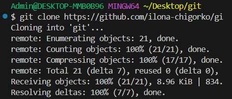
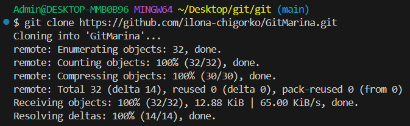
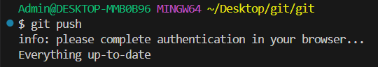
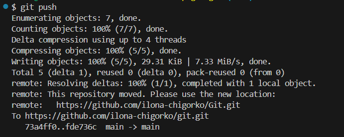
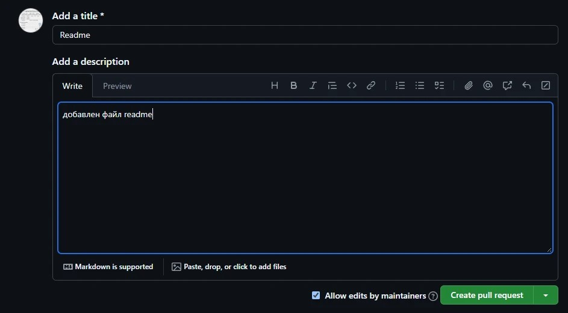

## 1. 
```
git version 
```
* Если Git установлен на компьютер, вы увидите его текущую версию

## 2. 
```
git init
```
* указываем папку, в которой git начнёт отслеживать изменения

* в папке создаётся скрытая папка .git

## 3. 
```
git status
```
* показывает текущее состояние гита, есть 

ли изменения, которые нужно закоммитить
(сохранить)

## 4. 
```
git add
```
* добавляет содержимое рабочего каталога 

в индекс (staging area) для последующего коммита. Эта команда дается после добавления
файлов. Писать название целиком не обязательно: терминал дозаполнит данные автоматически.

## 5. 
```
git commit
```
* зафиксировать или сохранить
По умолчанию __git commit__ использует лишь этот индекс, так что вы можете использовать __git add__ 

для сборки слепка вашего следующего коммита.
Команда __git commit__ берёт все данные, добавленные в индекс с помощью __git add__, и сохраняет их
слепок во внутренней базе данных, а затем сдвигает указатель текущей ветки на этот слепок.

## 6. 
```
git log
```
* Журнал изменений

* Перед переключением версии файла в Git
используйте команду git log, чтобы увидеть
количество сохранений

## 7. 
```
git checkout
```
* Переключение между версиями

* Для работы нужно указать не только
интересующий вас коммит, но и вернуться 

в тот, где работаем, при помощи команды __git checkout master__.

## 8. 
```
git diff
```
* Показывает разницу между текущим файлом и сохранённым
* Перед переключением версии файла в Git используйте команду git log, чтобы увидеть количество сохранений


## _Синтаксис языка Markdown_ 
* Жирный текст — *
* Курсивный текст — *
* Зачеркнутый текст — ~
* Выделяют заголовки — # в начале строки
* Показать уровень заголовка — подчеркивание знаками = или ****
* Нумерованные Списки — обозначаются обычными цифрами 1, 2, 3
* Ненумерованные Списки — обозначаются *знаками в начале строки
* Вложенные Списки — выполняем отступы


## 9. 
```
git branch <название новой ветки>
```
* Позволяет создать ветку в папке с репозиторием.


## 10. 
```
git merge_ <имя ветки для слияния с текущей>
```
* Команда для слияния веток


## 11. 
```
git ignore
```
* Команда для исключения не нужных файлов из загрузки


## 12. 
```
git clone
```
* Составная команда, она не только загружает все изменения, но и пытается слить все ветки в удаленном репозитории




## 13. 
```
git push
```
* Позволяет отправить свою версию репозитория во внешний репозиторий (нужна авторизация)




## 14. 
```
git pull
``` 
* команда позволяет скачать все из текущего репозитория и автоматически сделать merge с нашей версией


## 15. 
```
pull request
```
* Команда для предложения изменений




## 16.
```
git init
```


## 17.
```
git clone <path>
```


## 18.
```
git remote add origin <path>
```
* Связывает ваш локальный репозиторий с удалённым, давая удалённому имя origin


## 19.
```
git push -u origin master
```
* Отправляет ваши коммиты на удаленный сервер и связывает локальную ветку с удаленной


## 20.
```
git push origin <branch>
```
* Отправляет изменения в конкретную ветку на удаленном репозитории.


## 21.
```
git remote show origin
```
* Показывает подробную информацию об удаленном репозитории (адреса, какие ветки отслеживаются)


## 22.
```
git fetch
```
* Показывает подробную информацию об удаленном репозитории (адреса, какие ветки отслеживаются)


## 23.
```
git log remote_branch ^local_branch
```
* Показывает коммиты, которые есть в удаленной ветке, но которых еще нет в вашей локальной.


## 24.
```
git pull origin <branch>
```
* Скачивает изменения (fetch) и сразу же сливает их (merge) с вашим кодом.


## 25.
```
git remote -v
```
* Показывает короткие адреса (URL) привязанных удаленных репозиториев.


## 26.
```
git remote remove origin
```

* Отвязывает удаленный репозиторий.


## 27.
```
git remote set-url origin <new_path>
```
* Меняет URL удаленного репозитория на новый.


## 28.
```
git remote set-url --fetch и git remote set-url --push
```
* Позволяет разделить адреса


## 29.
```
git remote set-url --add --push origin <new_path>
```
* Добавляет дополнительный адрес для отправки изменений


## 30.
```
git fetch --all
```
* Скачивает изменения сразу из всех удаленных репозиториев, которые привязаны к вашему проекту (а не только из origin).


